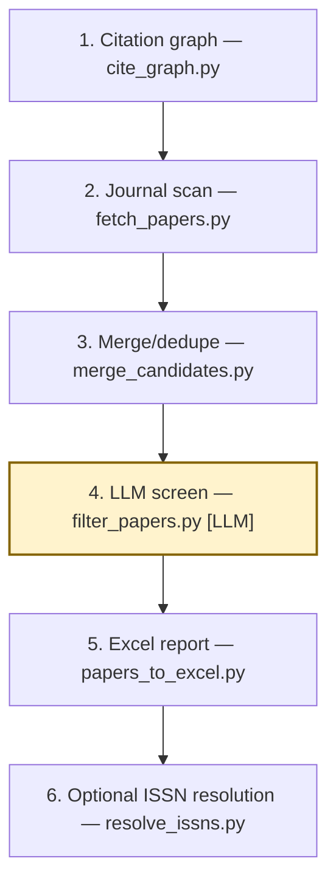

# Literature Search Pipeline

Find literature from seed papers and a research topic, then export an Excel report. The six tools use OpenAlex, arXiv, and an OpenAI-compatible model for semantic screening.



## Pipeline steps

1. **Citation graph:** `cite_graph.py` follows citing papers and references through the OpenAlex API, writing a graph and a flat candidate list.

2. **Journal scan:** `fetch_papers.py` scans journal ISSNs through the OpenAlex API and categories through the arXiv API, applying the profile's coarse keyword filter.

3. **Merge/dedupe:** `merge_candidates.py` deterministically merges candidate IDs, using DOI/URL fallbacks and retaining source tags and usable abstracts.

4. **LLM screen:** `filter_papers.py` makes the pipeline's only LLM calls through an OpenAI-compatible API, scoring titles and abstracts against the profile rubric and returning Chinese reasons and tags.

5. **Excel report:** `papers_to_excel.py` uses `openpyxl` to export the retained papers to a formatted workbook.

6. **Optional ISSN resolution:** `resolve_issns.py` queries the OpenAlex sources API for journal names in its `NAMES` list and prints ISSN lookup results.

## Usage

Prerequisites: Python 3.9+, network access to OpenAlex and arXiv, and an OpenAI-compatible LLM endpoint. Run from the repository root:

```bash
pip install -r requirements.txt
mkdir -p data
cp templates/config.json tools/config.json
cp templates/profiles.example.json tools/profiles.json
```

Edit `my_topic` in `tools/profiles.json`: set the topic, rubric, categories, and keywords; change `journals` to a mapping such as `{"Journal of Fluid Mechanics": ["0022-1120", "1469-468X"]}`. Set the endpoint, model, and key below (empty for a local endpoint); the existing script reads the key through `PAPER_LLM_API_KEY`.

```bash
export PAPER_LLM_BASE="http://127.0.0.1:1234/v1"
export PAPER_LLM_MODEL="qwen3.8-27b"
export PAPER_LLM_KEY=""
export PAPER_LLM_API_KEY="$PAPER_LLM_KEY"
export PAPER_DIGEST_DIR="$PWD/data"
cp tools/profiles.json data/profiles.json
```

Replace `<DOI-or-arXiv-ID>` with your seed, then run these six commands in order; the last is optional (edit `NAMES` first):

```bash
python3 tools/cite_graph.py --seed "<DOI-or-arXiv-ID>" --depth 2 --directions cites,refs --since-year 2010 --cites-per-seed 25 --refs-to-resolve 18 --out data/cite_candidates.json
python3 tools/fetch_papers.py --profile my_topic --days 3650 --out data/my_topic_search.json
python3 tools/merge_candidates.py --in data/cite_candidates_flat.json data/my_topic_search.json --out data/candidates.json --tags cite,journal
python3 tools/filter_papers.py --candidates data/candidates.json --profile my_topic --out data/my_topic_filtered.json
python3 tools/papers_to_excel.py --filtered data/my_topic_filtered.json --out data/my_topic_papers.xlsx
python3 tools/resolve_issns.py > data/issns.txt
```

The final `data/my_topic_papers.xlsx` contains an `Articles` sheet with No., Title, Journal, Year, and Web Link (DOI).

Full workflow + pitfalls: [skills/lit-search-pipeline/SKILL.md](skills/lit-search-pipeline/SKILL.md).
